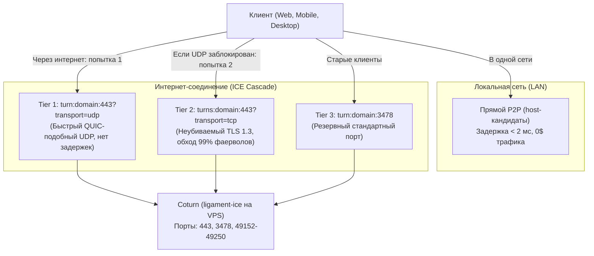

# Ligament ICE (STUN, TURN & TURNS TLS Server)

Автономный сервер обхода NAT и релея WebRTC-трафика для экосистемы **Ligament 2FA** (Корпоративный чат, видео/аудиозвонки и SOS-сессии удаленной помощи Ligament Link).

Сервер построен на базе высокопроизводительного `coturn` со встроенным автоматическим ACME-клиентом (`certbot`) для автоматического получения и продления SSL-сертификатов Let's Encrypt.

---

## Ключевые возможности

* **Защита от блокировок (TURNS 443 TCP TLS):** Трафик инкапсулируется в TLS 1.3 на стандартном HTTPS-порту `443`. Для систем DPI и сетевых фильтров (ТСПУ, корпоративные NGFW) сессия выглядит как обычное веб-соединение, что снижает вероятность блокировки до < 2%.
* **Минимальная задержка звука и видео (UDP 443):** Порт `443/udp` используется в первую очередь для чистого медиапотока под видом протокола HTTP/3 (QUIC) без задержек и заиканий (нет Head-of-Line blocking, свойственного TCP).
* **Встроенный ACME / Let's Encrypt:** Полная автоматизация выпуска и продления SSL-сертификатов с автоматическим выставлением прав доступа (`deploy-hook`), исключающим сбои Coturn после обновления ключей.
* **Скрытность:** Отключены отпечатки ПО (`no-software-attribute`), запрещен TCP-релей для защиты от использования сервера в качестве открытого прокси.
* **Обратная совместимость:** Сохранен резервный стандартный порт `3478` (UDP/TCP) для устаревших клиентов.

---

## Архитектура прохождения трафика



---

## 1. Быстрый старт на сервере

### Шаг 1: Подготовка домена и DNS
Создайте `A`-запись в DNS у вашего регистратора:
* **Имя поддомена:** например, `remote.grando.app` (или `ice.yourdomain.com`).
* **IP-адрес:** публичный IPv4-адрес вашего VPS.

> [!TIP]
> Рекомендуется использовать нейтральные имена поддоменов (`remote.`, `edge.`, `gateway.`, `cdn.`), избегая слов `turn`, `stun` или `vpn` для предотвращения фильтрации по SNI.

---

### Шаг 2: Клонирование и настройка окружения

```bash
# 1. Перейдите в рабочую директорию на сервере
cd /opt
git clone https://github.com/aligorov/ligament-ice.git
cd ligament-ice

# 2. Создайте файл окружения на основе примера
cp .env.example .env
nano .env
```

Заполните переменные в `.env`:
```env
# Доменное имя вашего сервера (совпадает с A-записью)
REALM=remote.grando.app

# Email для регистрации Let's Encrypt и уведомлений об окончании сертификата
ACME_EMAIL=admin@grando.app

# Внешний статический IPv4-адрес сервера (узнать: curl -4 ifconfig.me)
EXTERNAL_IP=5.149.155.214

# Учетные данные для WebRTC-клиентов
TURN_USER=ligament
TURN_PASSWORD=СгенерируйтеНадежныйПароль2026!
```

---

### Шаг 3: Настройка файрвола

Для работы всех компонентов на сервере должны быть открыты порты:

| Порт / Протокол | Назначение |
| :--- | :--- |
| **`80/tcp`** | Валидация домена Let's Encrypt (ACME HTTP-01 challenge) |
| **`443/tcp`** | Зашифрованный TURNS over TLS 1.3 (основной обход блокировок) |
| **`443/udp`** | Высокоскоростной TURN over UDP (основной медиапоток) |
| **`3478/tcp,udp`** | Стандартный порт STUN/TURN (резерв) |
| **`49152-49250/udp`** | Диапазон портов для релея медиаданных WebRTC |

#### Настройка через UFW (Ubuntu/Debian):
```bash
sudo ufw allow 80/tcp
sudo ufw allow 443/tcp
sudo ufw allow 443/udp
sudo ufw allow 3478/tcp
sudo ufw allow 3478/udp
sudo ufw allow 49152:49250/udp
sudo ufw reload
```

#### Настройка через iptables:
```bash
sudo iptables -A INPUT -p tcp --dport 80 -j ACCEPT
sudo iptables -A INPUT -p tcp --dport 443 -j ACCEPT
sudo iptables -A INPUT -p udp --dport 443 -j ACCEPT
sudo iptables -A INPUT -p tcp --dport 3478 -j ACCEPT
sudo iptables -A INPUT -p udp --dport 3478 -j ACCEPT
sudo iptables -A INPUT -p udp --dport 49152:49250 -j ACCEPT
```

---

### Шаг 4: Запуск контейнеров

```bash
docker compose up -d
```

Проверьте логи инициализации:
```bash
docker compose logs -f
```

**Что происходит автоматически:**
1. `certbot` проверяет наличие сертификата. Если его нет — обращается к Let's Encrypt по порту 80, подтверждает владение доменом и генерирует ключи в Docker volume `certs`.
2. Автоматически выставляются права `chmod 644` на приватный ключ.
3. `ice` (Coturn) ожидает появления сертификатов и успешно запускается на портах 443 и 3478.

---

## 2. Подключение к серверу Ligament 2FA (Core)

После успешного запуска сервера укажите его параметры в админ-панели Ligament:

1. Откройте веб-интерфейс Core: **«Поддержка» (`/admin/support`)**.
2. Найдите блок **«STUN/TURN-серверы для WebRTC»**.
3. Вставьте конфигурацию (замените `remote.grando.app` и `credential` на ваши):

```json
[
  {
    "urls": [
      "turn:remote.grando.app:443?transport=udp",
      "turns:remote.grando.app:443?transport=tcp",
      "stun:remote.grando.app:443",
      "turn:remote.grando.app:3478?transport=udp",
      "turn:remote.grando.app:3478?transport=tcp",
      "stun:remote.grando.app:3478"
    ],
    "username": "ligament",
    "credential": "СгенерируйтеНадежныйПароль2026!"
  }
]
```
4. Нажмите **«Сохранить настройки»**.
   * Новые настройки применятся мгновенно без перезапуска Core.
   * Все клиенты (Web-чат, мобильные приложения iOS/Android, Desktop) автоматически начнут использовать обновленный защищенный каскад.

---

## 3. Диагностика и проверка работы

### 1. Проверка из консоли через скрипт
В репозитории есть готовый скрипт диагностики:
```bash
./check_ice.sh remote.grando.app
```
Скрипт проверит:
* Корректность разрешения DNS A-записи.
* Успешность TLS-хэндшейка на порту 443 TCP.
* Доступность резервного порта 3478.
* STUN Binding по UDP.

### 2. Проверка в браузере (Trickle ICE)
1. Откройте официальный тестовый инструмент: [WebRTC Trickle ICE Sample](https://webrtc.github.io/samples/src/content/peerconnection/trickle-ice/).
2. Удалите стандартный STUN от Google.
3. Добавьте свои серверы:
   * **TURNS (TLS 443):** URI: `turns:remote.grando.app:443?transport=tcp`, User: `ligament`, Password: `...`
   * **TURN (UDP 443):** URI: `turn:remote.grando.app:443?transport=udp`, User: `ligament`, Password: `...`
   * **STUN:** URI: `stun:remote.grando.app:443`
4. Нажмите кнопку **Gather candidates**.
5. **Критерий успеха:** в таблице кандидатов должны появиться строки со статусом `relay` (TURNS) и `srflx` (STUN).

---

## 4. Траблшутинг (Решение частых проблем)

### Проблема А: Ошибка `Problem binding to port 80: Could not bind to IPv4 or IPv6`
* **Причина:** Порт 80 уже занят другим процессом на сервере (например, Nginx, Apache, Caddy).
* **Решение:**
  * Проверьте, кто занимает порт: `sudo lsof -i :80` или `sudo netstat -tulnp | grep :80`.
  * Если на этом VPS уже работает веб-сервер, настройте в нем выпуск сертификата Certbot Webroot или используйте DNS-валидацию (DNS-01 через Cloudflare API).

### Проблема Б: На VPS уже работает Nginx на порту 443
* **Решение:** Используйте Nginx Stream модуль с `ssl_preread` (SNI-маршрутизация). В этом случае Nginx на 443 порту смотрит на доменное имя:
  * Если запрос идет к `remote.grando.app` ➔ прозрачно пересылает в Coturn (на локальный порт 5349).
  * Все остальные веб-запросы ➔ отправляет на локальный веб-сайт (порт 8443).
  * Подробная конфигурация описана в архитектурном плане.

### Проблема В: Ошибка `Permission Denied` при чтении сертификатов
* **Решение:** Встроенный сервис `certbot` уже содержит команду автоматического выставления прав:
  ```bash
  chmod -R 755 /etc/letsencrypt/live /etc/letsencrypt/archive
  chmod 644 /etc/letsencrypt/live/*/privkey.pem
  ```
  Если права сбились вручную, выполните эту команду внутри тома или на хосте.

### Проблема Г: Как проверить продление сертификатов (Dry-Run)
Чтобы убедиться, что автопродление Let's Encrypt пройдет успешно без ошибок:
```bash
docker compose exec certbot certbot renew --dry-run
```
Если в выводе отображается `Congratulations, all simulated renewals succeeded` — автоматическое продление работает корректно.

---

## 5. Структура репозитория

```text
ligament-ice/
├── .env.example          # Шаблон переменных окружения
├── docker-compose.yml    # Описание контейнеров certbot и coturn
├── turnserver.conf       # Hardened-конфигурация Coturn (порты, шифры, SSRF-защита)
├── check_ice.sh          # Скрипт проверки связности и TLS-хэндшейка
└── README.md             # Полное руководство по развертыванию
```
